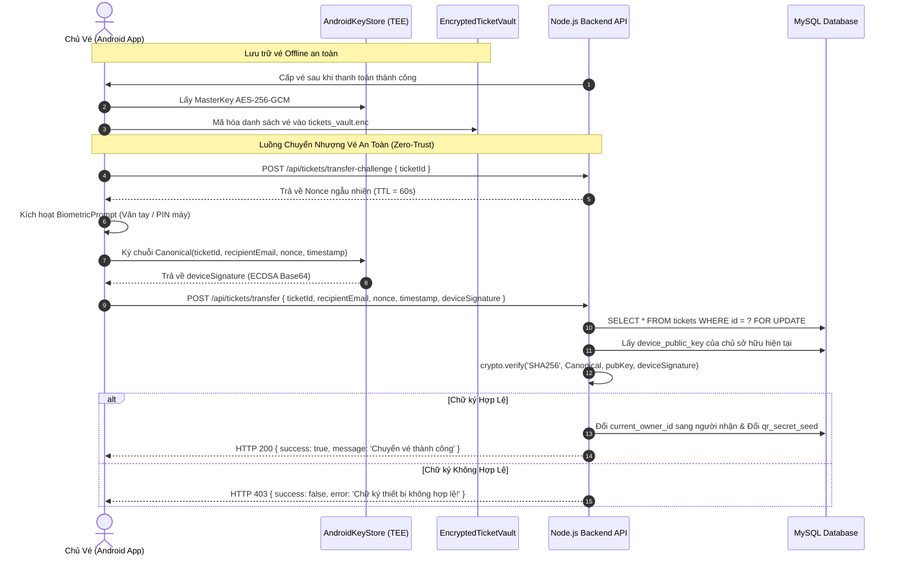

# Phase 2: Crypto Identity & Functional Security (Định Danh Mật Mã & Bảo Mật Nghiệp Vụ Vé)

## Overview
Củng cố toàn bộ tầng mật mã học và bảo mật chức năng nghiệp vụ vé: tách rời kho lưu trữ vé offline `EncryptedTicketVault` khỏi JWT token bằng cách dùng AndroidKeyStore MasterKey (AES-256-GCM) độc lập; ràng buộc chữ ký số phần cứng ECDSA P-256 từ điện thoại chính chủ kèm xác thực sinh trắc học khi thực hiện mua vé (`/buy`) và chuyển nhượng vé (`/transfer`) để triệt tiêu bot cURL và chống cướp vé khi lộ token; thiết lập kiến trúc Dual-Token (Access Token 15 phút + Refresh Token Rotation 7 ngày có thu hồi tức thì).

---

## Requirements

### Functional Requirements
- **FR-08 (Vault Độc Lập bằng MasterKey):** `EncryptedTicketVault.kt` sử dụng `MasterKey.Builder` của AndroidX Security sinh khóa AES-256-GCM lưu trữ trong phần cứng `AndroidKeyStore` (TEE/StrongBox), xóa bỏ hoàn toàn việc dẫn xuất khóa từ JWT access token hay fallback chuỗi tĩnh.
- **FR-09 (Chuyển Vé Có Chữ Ký Thiết Bị):** Endpoint `POST /api/tickets/transfer` bắt buộc nhận payload kèm `clientNonce`, `timestamp` và `deviceSignature`. Backend dùng `users.device_public_key` của chủ sở hữu vé để xác thực bằng ECDSA P-256. Nếu chữ ký sai hoặc thiếu $\rightarrow$ Reject HTTP 403 Forbidden.
- **FR-10 (Mua Vé Có Ràng Buộc Thiết Bị Chống Bot):** Endpoint `POST /api/tickets/buy` yêu cầu client gửi kèm chữ ký số từ AndroidKeyStore của thiết bị người dùng. Chặn đứng các script bot cURL/Python chạy không có chip phần cứng Android.
- **FR-11 (Biometric Re-authentication có Fallback Mã Khóa Máy):** Khi bấm nút Chuyển vé hoặc Mua vé trên Android, ứng dụng bắt buộc hiển thị `BiometricPrompt`. Hỗ trợ fallback sang mã PIN/Pattern màn hình khóa (`BIOMETRIC_STRONG or DEVICE_CREDENTIAL`) để không làm gián đoạn người dùng bị hỏng cảm biến vân tay.
- **FR-12 (Dual-Token Lifecycle & Rotation):**
  - Access Token giảm thời hạn xuống **15 phút**.
  - Refresh Token thời hạn **7 ngày**, lưu dạng mã băm SHA-256 trong bảng `user_refresh_tokens`.
  - Endpoint `POST /api/auth/refresh` áp dụng Refresh Token Rotation (thu hồi token cũ, cấp cặp token mới). Nếu phát hiện Refresh Token đã thu hồi bị gửi lại $\rightarrow$ Lập tức thu hồi toàn bộ token của tài khoản đó (phát hiện Token Theft).
- **FR-13 (OkHttp TokenAuthenticator Tự Động):** Client Android tự động gọi `/api/auth/refresh` khi nhận phản hồi HTTP 401 để duy trì phiên mượt mà không làm gián đoạn trải nghiệm người dùng.

### Non-functional Requirements
- **NFR-03 (Thời Gian Xác Thực Chữ Ký):** Quá trình ký số ECDSA trên Client $< 20\text{ ms}$; xác thực chữ ký ECDSA trên Backend $< 15\text{ ms}$.
- **NFR-04 (Độ Sẵn Sàng Ngoại Tuyến):** Khi ngắt mạng hoàn toàn (Airplane Mode), người dùng vẫn mở và giải mã được vé đã lưu trong `EncryptedTicketVault` để trình diện mã QR TOTP hoặc chạm NFC HCE.

---

## Architecture & Data Flow



---

## Related Code Files

### Create
- `backend/src/migrations/createRefreshTokenTable.js`
- `app/src/main/java/com/example/quan_ly_ticket/data/api/TokenAuthenticator.kt`

### Modify
- `backend/src/routes/authRoutes.js`
- `backend/src/routes/ticketRoutes.js`
- `backend/src/middlewares/authMiddleware.js`
- `app/src/main/java/com/example/quan_ly_ticket/data/local/EncryptedTicketVault.kt`
- `app/src/main/java/com/example/quan_ly_ticket/data/local/SecurePreferences.kt`
- `app/src/main/java/com/example/quan_ly_ticket/security/KeystoreManager.kt`
- `app/src/main/java/com/example/quan_ly_ticket/data/api/ApiClient.kt`
- `app/src/main/java/com/example/quan_ly_ticket/ui/screens/TicketDetailScreen.kt`
- `app/src/main/java/com/example/quan_ly_ticket/ui/screens/HomeScreen.kt`

---

## Implementation Steps

### 1. Backend: Thiết Lập Bảng và Logic Refresh Token Rotation
- Tạo file migration `backend/src/migrations/createRefreshTokenTable.js`:
  - Tạo bảng `user_refresh_tokens`:
    ```sql
    CREATE TABLE IF NOT EXISTS user_refresh_tokens (
      id VARCHAR(36) PRIMARY KEY,
      user_id VARCHAR(36) NOT NULL,
      token_hash VARCHAR(64) NOT NULL,
      expires_at DATETIME NOT NULL,
      revoked_at DATETIME NULL,
      replaced_by_token VARCHAR(64) NULL,
      created_at DATETIME DEFAULT CURRENT_TIMESTAMP,
      INDEX idx_token_hash (token_hash),
      INDEX idx_user_id (user_id),
      FOREIGN KEY (user_id) REFERENCES users(id) ON DELETE CASCADE
    );
    ```
- Chỉnh sửa `backend/src/routes/authRoutes.js`:
  - Rút ngắn thời gian JWT Access Token xuống `15m`.
  - Sinh Refresh Token (chuỗi ngẫu nhiên 64 bytes hex), băm SHA-256 lưu vào bảng `user_refresh_tokens` với hạn 7 ngày.
  - Viết endpoint `POST /api/auth/refresh`:
    - Nhận Refresh Token từ client, băm SHA-256 tra cứu trong DB.
    - Nếu token đã bị `revoked_at != null` (phát hiện tái sử dụng trái phép) $\rightarrow$ thu hồi toàn bộ token của User đó và trả về HTTP 403.
    - Nếu hợp lệ: đánh dấu revoked token cũ, sinh cặp Access Token và Refresh Token mới trả về cho client.
  - Viết endpoint `POST /api/auth/logout`: Đánh dấu thu hồi Refresh Token hiện tại.

### 2. Android: Nâng Cấp `EncryptedTicketVault` Dùng AndroidKeyStore MasterKey
- Chỉnh sửa `app/src/main/java/com/example/quan_ly_ticket/data/local/EncryptedTicketVault.kt`:
  - Xóa bỏ hàm `getOrCreateVaultKey()` cũ lấy dẫn xuất từ access token hoặc chuỗi tĩnh `"SecureTicket_Vault_MasterKey_32B"`.
  - Sử dụng AndroidX Security Crypto MasterKey:
    ```kotlin
    private val masterKey = MasterKey.Builder(context)
        .setKeyScheme(MasterKey.KeyScheme.AES256_GCM)
        .setRequestStrongBoxed(true) // Tự fallback TEE nếu không có StrongBox
        .build()
    ```
  - Khởi tạo `EncryptedFile` hoặc mã hóa chuỗi JSON danh sách vé bằng khóa AES-256-GCM từ MasterKey này.
  - Đảm bảo đọc/ghi vé bất đồng bộ trên `Dispatchers.IO` để không gây giật lag giao diện Compose.

### 3. Backend & Android: Ràng Buộc Chữ Ký Số Khi Mua Vé và Chuyển Vé
- **Android - Cập nhật `KeystoreManager.kt`:**
  - Bổ sung hàm:
    ```kotlin
    fun signTransferPayload(ticketId: String, recipientEmail: String, nonce: String, timestamp: Long): String {
        val canonical = "TRANSFER:$ticketId:$recipientEmail:$nonce:$timestamp"
        return signChallenge(canonical.toByteArray(Charsets.UTF_8))
    }
    ```
- **Android - Cập nhật `TicketDetailScreen.kt` & `MainActivity.kt`:**
  - Khi bấm nút "Chuyển nhượng vé":
    - Gọi API lấy `nonce` ngẫu nhiên từ server.
    - Hiển thị `BiometricPrompt` yêu cầu xác thực vân tay hoặc mã khóa máy (`BIOMETRIC_STRONG or DEVICE_CREDENTIAL`).
    - Khi xác thực thành công $\rightarrow$ gọi `KeystoreManager.signTransferPayload(...)` lấy chữ ký số.
    - Gửi request `POST /api/tickets/transfer` kèm `{ ticketId, recipientEmail, nonce, timestamp, deviceSignature }`.
- **Backend - Cập nhật `backend/src/routes/ticketRoutes.js`:**
  - Tại route `POST /transfer`:
    - Đọc các trường: `ticketId`, `recipientEmail`, `nonce`, `timestamp`, `deviceSignature`.
    - Kiểm tra `timestamp` không lệch quá 60 giây.
    - Lấy `users.device_public_key` của người gửi từ DB.
    - Tạo lại chuỗi canonical và xác minh chữ ký:
      ```javascript
      const canonical = `TRANSFER:${ticketId}:${recipientEmail}:${nonce}:${timestamp}`;
      const isValid = verifyDeviceSignature(canonical, deviceSignature, ownerPublicKeyPem);
      if (!isValid) {
        await conn.rollback();
        return res.status(403).json({ success: false, error: 'Chữ ký thiết bị không hợp lệ hoặc không chính chủ!' });
      }
      ```
    - Nếu hợp lệ: Cập nhật chủ sở hữu mới trong giao dịch `FOR UPDATE` và cấp đổi `qr_secret_seed` mới cho vé.

### 4. Android: Triển Khai `TokenAuthenticator` Tự Động Làm Mới Phiên
- Tạo file `app/src/main/java/com/example/quan_ly_ticket/data/api/TokenAuthenticator.kt`:
  - Cài đặt giao diện `okhttp3.Authenticator`:
  - Khi nhận response có code `401 Unauthorized`:
    - Khóa đồng bộ (synchronized) để tránh spam request refresh.
    - Lấy refresh token từ `SecurePreferences`, gọi đồng bộ API `/api/auth/refresh`.
    - Nếu refresh thành công: Lưu Access Token mới vào `SecurePreferences` và retry request gốc với Authorization header mới.
    - Nếu refresh thất bại: Xóa session và chuyển người dùng về màn hình Đăng nhập.
- Gắn `TokenAuthenticator` vào `OkHttpClient.Builder` trong `ApiClient.kt`.

---

## Success Criteria
- [ ] Bật chế độ máy bay trên điện thoại $\rightarrow$ Mở ứng dụng, danh sách vé đã lưu vẫn hiển thị đầy đủ và mã QR động TOTP vẫn quay vòng bình thường.
- [ ] Dùng công cụ cURL/Postman với Access Token của User A gửi request chuyển vé không có `deviceSignature` $\rightarrow$ Server trả về HTTP `403 Forbidden` kèm audit log cảnh báo.
- [ ] Chuyển vé thành công trên điện thoại có xác thực vân tay $\rightarrow$ Chủ cũ mất quyền xem mã QR hợp lệ; chủ mới nhận vé kèm seed mới trong database.
- [ ] Đợi 16 phút để Access Token hết hạn, sau đó mở app xem vé $\rightarrow$ `TokenAuthenticator` tự động refresh trong nền mà người dùng không bị văng ra màn hình đăng nhập.
- [ ] Giả lập gửi lại một Refresh Token đã từng bị thu hồi $\rightarrow$ Server trả về HTTP 403 và thu hồi toàn bộ token thuộc về user đó.

---

## Risk Assessment
- **Rủi ro:** Thiết bị khách hàng không hỗ trợ cảm biến vân tay hoặc mồ hôi tay không nhận dạng được.
  - *Dấu hiệu nhận biết:* Người dùng không thể vượt qua bước `BiometricPrompt` để chuyển vé.
  - *Biện pháp dự phòng:* Cấu hình `setAllowedAuthenticators(BIOMETRIC_STRONG or DEVICE_CREDENTIAL)` cho phép nhập PIN/mật mã màn hình khóa của điện thoại làm phương án thay thế an toàn.
- **Rủi ro:** Thiết bị Android đời cũ bị trễ thời gian sinh khóa trong AndroidKeyStore.
  - *Dấu hiệu nhận biết:* Màn hình chuyển vé bị đơ nhẹ.
  - *Biện pháp dự phòng:* Đẩy toàn bộ thao tác ký số sang luồng `Dispatchers.Default`, hiển thị vòng xoay tiến trình mượt mà trên Jetpack Compose.
