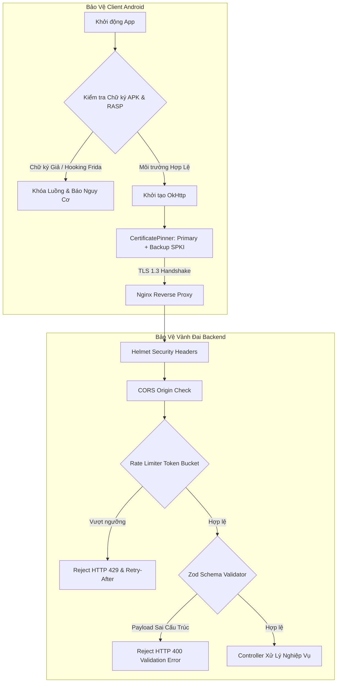

# Phase 3: Perimeter Hardening, RASP & Verification (Vành Đai Ngoại Vi, RASP & Kiểm Thử Red-Team)

## Overview
Thiết lập vành đai phòng thủ kiên cố cho Backend API (HTTP Security Headers với Helmet, CORS Whitelist nghiêm ngặt, Zod Schema Validation, Rate Limiting đa tầng chống brute-force và DDoS); kích hoạt cơ chế tự vệ chủ động (Adaptive RASP) và Certificate Pinning an toàn (có mã băm SPKI backup) trên Android; xây dựng và thực thi bộ kiểm thử tự động Red-Team để chứng minh hệ thống đã sạch bóng các lỗ hổng đã xác định.

---

## Requirements

### Functional Requirements
- **FR-14 (HTTP Security Headers):** Backend tích hợp `helmet` với HSTS (`max-age=31536000`), CSP, `X-Content-Type-Options: nosniff`, `X-Frame-Options: DENY`.
- **FR-15 (Strict CORS Policy):** Cấu hình CORS chỉ cho phép danh sách Origin cụ thể của hệ thống quản trị nội bộ hoặc chặn các request từ web domain lạ; loại bỏ hoàn toàn `origin: '*'`.
- **FR-16 (Input Schema Validation với Zod):** 100% routes nhạy cảm (`/api/auth/*`, `/api/tickets/*`, `/api/payment/*`) có middleware kiểm tra cấu trúc dữ liệu bằng Zod. Từ chối ngay lập tức các payload chứa trường lạ, sai kiểu dữ liệu hoặc injection payload với HTTP 400.
- **FR-17 (Rate Limiting Phân Tầng):**
  - Route `/api/auth/login`: Tối đa 5 lần / phút / IP.
  - Route `/api/tickets/buy`: Tối đa 10 lần / phút / User.
  - Route `/api/validate/validate-qr`: Tối đa 30 lần / phút / Staff.
  - Route `/api/payment/sepay-webhook`: Tối đa 100 lần / phút.
- **FR-18 (Certificate Pinning An Toàn trên Android):** Ghim tối thiểu 2 mã băm SHA-256 SPKI trong OkHttp (1 mã băm của chứng chỉ SSL hiện tại và 1 mã băm của Intermediate CA Let's Encrypt hoặc chứng chỉ dự phòng). Bật trên bản Release.
- **FR-19 (Adaptive RASP trên Android):**
  - Bản **Debug**: Ghi cảnh báo Root/Debugger vào log nhưng cho phép lập trình viên tiếp tục test/debug.
  - Bản **Release**: Nếu phát hiện Root (RootBeer), Debugger đang gắn, hoặc Frida/Xposed hooking $\rightarrow$ hiển thị thông báo an ninh văn minh, khóa chức năng chuyển vé, mua vé và ẩn mã QR động; không hard-kill đột ngột gây hoảng loạn cho người dùng thông thường.
- **FR-20 (Anti-Tampering / Signature Check):** Kiểm tra chữ ký APK khi khởi chạy ứng dụng; từ chối hoạt động nếu phát hiện ứng dụng bị dịch ngược và ký lại bằng khóa lạ.
- **FR-21 (Bộ Kiểm Thử Tự Động Red-Team):** Kịch bản kiểm thử tự động kiểm tra toàn bộ 7 ca thử nghiệm bảo mật cốt lõi.

### Non-functional Requirements
- **NFR-05 (Thời Gian Khởi Động RASP):** Việc kiểm tra RASP tại `Application.onCreate` không làm tăng quá 100ms thời gian khởi động ứng dụng.
- **NFR-06 (Khả Năng Xoay Vòng Pinning):** Khi máy chủ gia hạn chứng chỉ SSL tự động qua `certbot renew --reuse-key`, ứng dụng không bị mất kết nối mạng.

---

## Architecture & Data Flow



---

## Related Code Files

### Create
- `backend/src/middlewares/validationMiddleware.js`
- `backend/src/schemas/authSchemas.js`
- `backend/src/schemas/ticketSchemas.js`
- `backend/src/test/securityRedTeamTest.js`

### Modify
- `backend/src/index.js`
- `backend/package.json`
- `app/src/main/java/com/example/quan_ly_ticket/data/api/ApiClient.kt`
- `app/src/main/java/com/example/quan_ly_ticket/security/SecurityCheck.kt`
- `app/src/main/java/com/example/quan_ly_ticket/MainActivity.kt`
- `app/proguard-rules.pro`

---

## Implementation Steps

### 1. Backend: Cài Đặt Dependencies và Thiết Lập Vành Đai Bảo Vệ
- Chạy lệnh cài đặt thư viện:
  ```bash
  cd backend && npm install helmet express-rate-limit zod
  ```
- Cập nhật `backend/src/index.js`:
  - Thêm `helmet()` với cấu hình chuẩn HSTS và CSP.
  - Cấu hình `cors()` với danh sách `allowedOrigins` từ biến môi trường `ALLOWED_ORIGINS`.
  - Cấu hình các bộ `rateLimit` middleware và gắn vào các router tương ứng.

### 2. Backend: Tích Hợp Schema Validation Với Zod
- Tạo thư mục `backend/src/schemas/` và các file:
  - `authSchemas.js`: Schema cho `/register`, `/login`, `/refresh`.
  - `ticketSchemas.js`: Schema cho `/buy`, `/transfer`, `/validate-qr`.
- Tạo middleware `backend/src/middlewares/validationMiddleware.js`:
  ```javascript
  export const validateBody = (schema) => (req, res, next) => {
    const result = schema.safeParse(req.body);
    if (!result.success) {
      return res.status(400).json({
        success: false,
        error: 'Dữ liệu đầu vào không hợp lệ',
        details: result.error.errors.map(e => ({ field: e.path.join('.'), message: e.message }))
      });
    }
    req.validatedBody = result.data;
    next();
  };
  ```
- Gắn middleware này vào các router trước khi vào controller xử lý.

### 3. Android: Kích Hoạt Certificate Pinning Với SPKI Backup
- Cập nhật `app/src/main/java/com/example/quan_ly_ticket/data/api/ApiClient.kt`:
  - Trích xuất mã băm SHA-256 Public Key của chứng chỉ SSL chính thức và Intermediate CA (Let's Encrypt ISRG Root X1 / R3):
    ```kotlin
    val certificatePinner = CertificatePinner.Builder()
        .add("api.secureticket.vn", "sha256/PRIMARY_SPKI_HASH_BASE64=")
        .add("api.secureticket.vn", "sha256/BACKUP_SPKI_HASH_BASE64=")
        .build()
    ```
  - Bật `enableCertificatePinning = !BuildConfig.DEBUG` để lập trình viên vẫn debug được ở local.

### 4. Android: Nâng Cấp Adaptive RASP & Anti-Tampering
- Chỉnh sửa `app/src/main/java/com/example/quan_ly_ticket/security/SecurityCheck.kt`:
  - Bổ sung hàm kiểm tra chữ ký APK (`verifyAppSignature`): So sánh mã băm SHA-256 của signing certificate với mã băm chuẩn đã định nghĩa.
  - Phân tách phản ứng:
    - Trong `MainActivity.kt`: Nếu phát hiện cờ Root/Frida trên bản Release $\rightarrow$ Kích hoạt chế độ `isRestrictedMode = true`: Cho phép hiển thị vé đã mua nhưng khóa nút "Chuyển vé" và "Mua vé", hiển thị banner cảnh báo: *"Thiết bị có dấu hiệu can thiệp hệ thống. Các tính năng tài chính bị giới hạn để bảo vệ tài sản của bạn."*

### 5. Backend: Xây Dựng Bộ Kịch Bản Tự Động Red-Team
- Tạo file `backend/src/test/securityRedTeamTest.js`:
  - **Test Case 1 (Webhook Forgery):** Gửi webhook SePay không chữ ký $\rightarrow$ Phải nhận 401.
  - **Test Case 2 (Webhook Replay Attack):** Gửi webhook SePay với timestamp 10 phút trước $\rightarrow$ Phải nhận 401.
  - **Test Case 3 (Bot Buy Protection):** Gửi lệnh mua vé thiếu `deviceSignature` $\rightarrow$ Phải nhận 403.
  - **Test Case 4 (Unauthorized Transfer):** Dùng token User A chuyển vé của User A nhưng chữ ký thiết bị không khớp $\rightarrow$ Phải nhận 403.
  - **Test Case 5 (Rate Limit Enforcement):** Gửi 6 request login sai liên tiếp $\rightarrow$ Request thứ 6 nhận 429.
  - **Test Case 6 (Schema Poisoning):** Gửi payload JSON chứa prototype pollution hoặc trường lạ $\rightarrow$ Phải nhận 400.
  - **Test Case 7 (Token Reuse Detection):** Giả lập dùng lại Refresh Token đã revoked $\rightarrow$ Toàn bộ phiên của user bị hủy.

---

## Success Criteria
- [ ] Chạy lệnh `npm test` hoặc `node src/test/securityRedTeamTest.js` $\rightarrow$ 100% (7/7) các ca thử nghiệm bảo mật đều PASSED.
- [ ] Gửi request login thứ 6 trong vòng 1 phút từ cùng 1 IP $\rightarrow$ Server trả về mã HTTP `429 Too Many Requests`.
- [ ] Dùng Burp Suite có cài Root CA tự ký chặn bắt traffic của bản Release APK $\rightarrow$ Kết nối bị từ chối với `SSLPeerUnverifiedException`.
- [ ] Chạy bản Release trên máy đã root $\rightarrow$ Ứng dụng hiển thị banner cảnh báo rủi ro an ninh và vô hiệu hóa nút Chuyển vé, không bị crash hay hard-kill đột ngột.
- [ ] Kiểm tra response headers của Backend bằng `curl -I https://api.secureticket.vn/health` $\rightarrow$ Có đầy đủ các header: `Strict-Transport-Security`, `X-Content-Type-Options: nosniff`, `X-Frame-Options: DENY`.

---

## Risk Assessment
- **Rủi ro:** Chứng chỉ Let's Encrypt tự động cấp mới làm đổi mã băm Pinning khiến toàn bộ app bị ngắt kết nối.
  - *Dấu hiệu nhận biết:* Người dùng báo lỗi kết nối mạng hàng loạt dù server vẫn hoạt động.
  - *Biện pháp dự phòng:* Đã ghim mã băm của Intermediate CA trong `CertificatePinner` và cấu hình certbot với cờ `--reuse-key`.
- **Rủi ro:** Thiết bị khách hàng bị RootBeer báo nhầm là Root do chạy ROM tùy biến (False Positive).
  - *Dấu hiệu nhận biết:* Khách hàng thông thường phàn nàn bị hiển thị banner cảnh báo rủi ro.
  - *Biện pháp dự phòng:* Hệ thống áp dụng cơ chế Adaptive RASP (không thoát app, vẫn cho phép mở vé offline để vào cửa bình thường).
