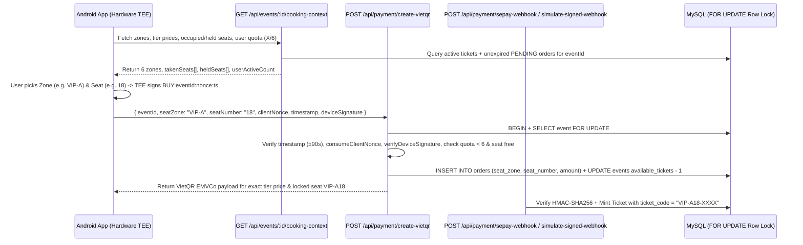

# Phase 1: Backend Security Parity, Seat-Locking Booking & Lifecycle APIs

## Overview
Upgrade the Node.js/Express/MySQL backend (`backend/src/routes/`) to close the hardware signature and anti-scalping bypass on `POST /api/payment/create-vietqr`, replace `Math.random()` seat assignment with real deterministic 6-zone tier pricing and atomic seat locking (`SELECT ... FOR UPDATE`), and expose endpoints for booking context, order history, HMAC-signed webhook simulation, ticket provenance, and hardware-signed ticket refunds.

## Requirements
- **Functional**:
  - Auto-migrate `orders` table on startup to add `seat_zone VARCHAR(32) NULL` and `seat_number VARCHAR(16) NULL` if absent.
  - Define canonical 6-Zone Tier metadata (`STAGE-V`: `1.5x` = 3,000 ₫, `VIP-A`: `1.4x` = 2,800 ₫, `VIP-B`: `1.3x` = 2,600 ₫, `PLATINUM`: `1.2x` = 2,400 ₫, `FANZONE`: `1.1x` = 2,200 ₫, `PREM-S`: `1.0x` = 2,000 ₫) with deterministic seat grid numbers (`10`–`49` per zone).
  - Add `GET /api/events/:id/booking-context` in `eventRoutes.js` returning the event, the 6 zone tiers with computed prices, taken/held seat codes (`VIP-A12`, etc. from active `tickets` and active `PENDING` `orders`), and the authenticated user's current active ticket + pending order count against `MAX_ACTIVE_TICKETS_PER_EVENT = 6`.
  - Harden `POST /api/payment/create-vietqr` in `paymentRoutes.js` to require `clientNonce`, `timestamp`, and `deviceSignature`, verify `verifyDeviceSignature("BUY:" + eventId + ":" + clientNonce + ":" + timestamp, deviceSignature, user.device_public_key)`, enforce `MAX_ACTIVE_TICKETS_PER_EVENT = 6`, lock the selected `(seatZone, seatNumber)` against double-booking, and persist the exact chosen `seat_zone`, `seat_number`, and tier `amount` into `orders` and `issueTicketOnPayment()`.
  - Add `GET /api/payment/my-orders` and `POST /api/payment/simulate-signed-webhook` (which constructs a genuine SePay payload, computes or intentionally tampers with the `HMAC-SHA256` signature for red-team testing, and verifies it through the real HMAC pipeline).
  - Add `GET /api/tickets/:id/provenance` and hardware-signed `POST /api/tickets/:id/refund` in `ticketRoutes.js`.
- **Non-functional**:
  - Maintain backward compatibility with existing seeded tickets (`ticket_code` format `${zone}${seatNum}-${suffix}`) and existing `securityRedTeamTest.js` test cases.
  - Use existing `consumeClientNonce` in `securityMiddleware.js` and existing `orders` table (zero duplicate tables).

## Architecture

## Related Code Files
- Modify: `backend/src/routes/eventRoutes.js`
- Modify: `backend/src/routes/paymentRoutes.js`
- Modify: `backend/src/routes/ticketRoutes.js`
- Modify: `backend/src/index.js`

## Implementation Steps
1. **Idempotent `orders` Schema Upgrade (`paymentRoutes.js` & `index.js`)**:
   - Export `ensureOrderColumns()` from `paymentRoutes.js` and call it on server startup in `index.js` to safely execute `ALTER TABLE orders ADD COLUMN seat_zone VARCHAR(32) NULL` and `ALTER TABLE orders ADD COLUMN seat_number VARCHAR(16) NULL` (ignoring `ER_DUP_FIELDNAME` if already added).
2. **Zone Tiers & Real-Time Seat Map Context (`eventRoutes.js`)**:
   - Add `GET /api/events/:id/booking-context` (with optional `Authorization` token parsing so logged-in users get their personal `userActiveTickets` and `userPendingOrders` counts).
   - Parse existing `tickets.ticket_code` prefixes (e.g. `VIP-A12-8F91` → zone `VIP-A`, seat `12`) and active `orders` (`status = 'PENDING' AND expires_at > NOW()`) to return exact `soldSeats` and `heldSeats` per zone alongside the 6 tier definitions (`STAGE-V`, `VIP-A`, `VIP-B`, `PLATINUM`, `FANZONE`, `PREM-S`).
3. **Harden `POST /api/payment/create-vietqr` & Deterministic Seat Issuance (`paymentRoutes.js`)**:
   - Enforce mandatory `deviceSignature`, `clientNonce`, and `timestamp` (±90s), consume `vietqr:${clientNonce}`, and verify `verifyDeviceSignature("BUY:" + String(eventId).trim() + ":" + clientNonce + ":" + timestamp, deviceSignature, user.device_public_key)` when `user.device_public_key` is present (returning HTTP `403` and logging `BOT_BUY_ATTEMPT_BLOCKED` / `BUY_REPLAY_NONCE_BLOCKED` on failure).
   - Enforce `MAX_ACTIVE_TICKETS_PER_EVENT = 6` across `tickets` (`status = 'ACTIVE'`) + `orders` (`status = 'PENDING' AND expires_at > NOW()`) for `(req.user.id, eventId)`.
   - Validate `seatZone` and `seatNumber` (defaulting to an available seat in the chosen zone if `seatNumber` is omitted), reject with HTTP `409` (`SEAT_ALREADY_TAKEN`) if already sold or held in another active `PENDING` order, compute the deterministic tier price (`Math.round((basePrice * multiplier) / 100) * 100`), store `seat_zone` and `seat_number` in `orders`, and use `order.seat_zone` + `order.seat_number` in `issueTicketOnPayment()` instead of `Math.random()`.
4. **Order History & HMAC-Signed Webhook Simulator (`paymentRoutes.js`)**:
   - Add `GET /api/payment/my-orders` returning the user's orders (`PENDING`, `PAID`, `EXPIRED`, `CANCELLED`) joined with `events` and `tickets` (including `seat_zone`, `seat_number`, `order_code`, `amount`, `qrPayload`, `ttlSeconds`, and `server_signature` snippet).
   - Add `POST /api/payment/simulate-signed-webhook` accepting `{ orderId, orderCode, attackMode }`. Build a real SePay webhook JSON payload (`transferType: 'in'`, `content: 'SECURE ' + order.order_code`, `transferAmount: order.amount`), sign `${timestamp}.${rawBody}` with `HMAC-SHA256` using `webhookSecret` (or corrupt the signature if `attackMode === 'INVALID_HMAC'`), and verify it through the exact same HMAC + `timingSafeEqual` check, logging `SEPAY_WEBHOOK_INVALID_SIGNATURE` (`401`) on attack or minting the signed ticket (`200`) on valid HMAC.
5. **Ticket Provenance, Self-Service Refund &Quota Check (`ticketRoutes.js`)**:
   - Enforce `MAX_ACTIVE_TICKETS_PER_EVENT = 6` in `POST /api/tickets/buy`.
   - Add `GET /api/tickets/:id/provenance` returning the ticket's cryptographic certificate metadata (`canonicalString`, `serverSignature`, `deviceBoundPublicKey`, `seatZone`, `seatNumber`, `issuedAt`, `issuedTimestamp`) and chronological `ticket_transfers` chain (`fromName`, `fromEmailMasked`, `toName`, `toEmailMasked`, `transferSignature`, `transferredAt`).
   - Add `POST /api/tickets/:id/refund` requiring `{ clientNonce, timestamp, deviceSignature, reason }`, verifying `REFUND:${ticketId}:${clientNonce}:${timestamp}` via `verifyDeviceSignature`, atomically setting `tickets.status = 'REFOKED'` / `'CANCELLED'`, rotating `qr_secret_seed`, restoring `events.available_tickets + 1`, and logging `TICKET_REFUNDED_BY_OWNER`.

## Success Criteria
- [x] `node --check backend/src/index.js && node --check backend/src/routes/eventRoutes.js && node --check backend/src/routes/paymentRoutes.js && node --check backend/src/routes/ticketRoutes.js` passes with exit code `0`.
- [x] `POST /api/payment/create-vietqr` rejects unsigned requests (`403`), replayed nonces (`403`), >6 tickets per event (`403`/`429`), and duplicate `(seatZone, seatNumber)` reservations (`409`).
- [x] `GET /api/events/:id/booking-context`, `GET /api/payment/my-orders`, `POST /api/payment/simulate-signed-webhook`, `GET /api/tickets/:id/provenance`, and `POST /api/tickets/:id/refund` return accurate, cryptographically verified responses.

## Risk Assessment
- **Risk**: Legacy seeded accounts in MySQL may have a stale or null `device_public_key` until the Android client calls `POST /api/auth/bind-device`.
  - *Signal*: `POST /api/payment/create-vietqr` returns `403 Chữ ký số phần cứng không khớp` after switching demo accounts.
  - *Mitigation*: Ensure `LoginScreen.kt` (including the Evaluator Role Switcher) always invokes `api.bindDevice(BindDeviceRequest(KeystoreManager.getDevicePublicKeyBase64()))` immediately upon login/switch, and verify `deviceSignature` against `user.device_public_key` when bound.
