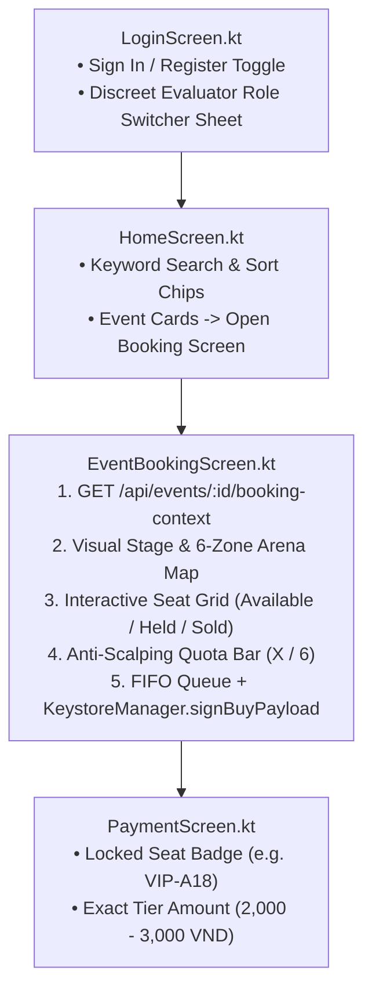

# Phase 2: Production Auth, Discovery & Interactive Seat-Picker Booking

## Overview
Upgrade the Android authentication, event discovery, and booking experience so `LoginScreen.kt` supports live registration and a discreet Evaluator Role Switcher, `HomeScreen.kt` provides real-time search and sorting, and tapping any event opens a dedicated **`EventBookingScreen.kt`** with a Visual Stage & Arena Map, 6 Ticket Tiers (`2,000–3,000 ₫`), an Interactive Seat Matrix Picker (`Available` / `Held 5m` / `Sold`), a Personal Anti-Scalping Quota Meter (`X / 6 vé`), and Hardware TEE ECDSA P-256 Seat Locking.

## Requirements
- **Functional**:
  - Update `Models.kt`, `TicketApiService.kt`, and `KeystoreManager.kt` (`signRefundPayload`) with all new DTOs and API endpoints from Phase 1.
  - Upgrade `LoginScreen.kt`:
    - Add a **Đăng nhập / Đăng ký tài khoản** segmented toggle wired to `POST /api/auth/register` (collecting Full Name, Email, Phone, Password, encrypting PII in `EncryptedTicketVault`, and binding the hardware `AndroidKeyStore` ECDSA P-256 public key).
    - Remove the large inline `"Tài khoản dùng thử"` card from the main login screen and replace it with a subtle footer chip `"Evaluator Role Switcher"` that opens a clean bottom sheet for 1-tap switching between Customer A/B/C, Staff, and Organizer.
  - Upgrade `HomeScreen.kt`:
    - Add real-time keyword search (by event title/location) and sort pills (`Sắp diễn ra`, `Giá thấp → cao`, `Còn nhiều vé`) on the Events tab.
    - Add a quick-access **"Đơn hàng & Biên lai"** chip/button in the header/wallet card to view pending and paid orders.
    - Change event card clicks to navigate to `EventBookingScreen.kt` instead of jumping straight into `joinQueue` / `PaymentScreen.kt`.
  - Create `EventBookingScreen.kt`:
    - Render event cover hero, date/time, venue, organizer, and security protections pill (`Hardware TEE Signed · Anti-Scalp Max 6 · Dynamic 30s TOTP`).
    - Render a **Personal Anti-Scalping Quota Bar** (`Đang giữ / sở hữu: X / 6 vé tối đa cho sự kiện này`).
    - Render a **Visual Stage & Arena Zone Map** (`MAIN STAGE 360°` + interactive zone blocks for `STAGE-V`, `VIP-A`, `VIP-B`, `PLATINUM`, `FANZONE`, `PREM-S`) and a **6-Tier Ticket Type Selector** showing tier price (`2,000 ₫` to `3,000 ₫`), perks, and remaining seats.
    - Render an **Interactive Seat Grid Picker** (40 seats per zone, e.g., `10`–`49`) with 3 live states from `GET /api/events/:id/booking-context`: **Trống (Available)**, **Đang giữ 5p (Held in PENDING order)**, and **Đã bán (Sold)**.
    - Bottom sticky booking bar displaying the selected Tier + Seat (`VD: VIP-A · Ghế 18 · 2.800 ₫`), joining the FIFO Virtual Waiting Room (`joinQueue`), signing `BUY:<eventId>:<nonce>:<timestamp>` with `KeystoreManager.signBuyPayload`, and calling `createPaymentOrder` with `seatZone` and `seatNumber`.
- **Non-functional**:
  - Preserve the `Swiss Precision Daylight` + `Dark Obsidian CryptoTerminalBox` design tokens from `Theme.kt` and `CommonComponents.kt`.
  - Zero raw Material `Card(` calls or inline structural emojis in `ui/screens/`.

## Architecture

## Related Code Files
- Modify: `app/src/main/java/com/example/quan_ly_ticket/data/model/Models.kt`
- Modify: `app/src/main/java/com/example/quan_ly_ticket/data/api/TicketApiService.kt`
- Modify: `app/src/main/java/com/example/quan_ly_ticket/security/KeystoreManager.kt`
- Modify: `app/src/main/java/com/example/quan_ly_ticket/ui/screens/LoginScreen.kt`
- Modify: `app/src/main/java/com/example/quan_ly_ticket/ui/screens/HomeScreen.kt`
- Create: `app/src/main/java/com/example/quan_ly_ticket/ui/screens/EventBookingScreen.kt`
- Modify: `app/src/main/java/com/example/quan_ly_ticket/MainActivity.kt`

## Implementation Steps
1. **Update Models, API Interface & Keystore Helper**:
   - In `Models.kt`, add `seatZone: String? = null` and `seatNumber: String? = null` to `CreateOrderRequest`, `CreateOrderData`, `OrderStatusData`, and `Ticket`; add `ZoneTierInfo`, `BookingContextData`, `OrderHistoryItem`, `SignedWebhookSimRequest`, `SignedWebhookSimData`, `ProvenanceTransferHop`, `TicketProvenanceData`, and `RefundTicketRequest`.
   - In `TicketApiService.kt`, add `getEventBookingContext`, `getMyOrders`, `simulateSignedWebhook`, `getTicketProvenance`, and `refundTicket`.
   - In `KeystoreManager.kt`, add `signRefundPayload(ticketId: String, nonce: String, timestamp: Long): String` signing `"REFUND:${ticketId.trim()}:$nonce:$timestamp"`.
2. **Refactor `LoginScreen.kt` for Production Auth & Discreet Role Switcher**:
   - Add a `isRegisterMode` segmented pill (`Đăng nhập` | `Đăng ký mới`). In register mode, show `Họ và tên` and `Số điện thoại (Mã hóa AES-256-GCM)` fields, call `api.register(...)`, then auto-login and bind the device's hardware ECDSA public key.
   - Replace the inline `"Tài khoản dùng thử"` card with a compact footer chip `"Chuyển nhanh tài khoản kiểm thử (Evaluator)"` that opens a `ModalBottomSheet` containing the 5 test personas (`KH A - Minh Anh`, `KH B - Hoàng Nam`, `KH C - Khánh Linh`, `Nhân viên Soát vé`, `Ban Tổ Chức`).
3. **Add Search, Sort & Navigation Hook in `HomeScreen.kt`**:
   - Add an event search bar and sort filter row (`Tất cả`, `Âm nhạc`, `An toàn TT`, `Esports & Tech` + sort toggle `Sắp diễn ra` / `Còn nhiều vé`) to `HomeMainView`.
   - Pass `onSelectEvent: (Event) -> Unit` from `HomeScreen` to `MainActivity.kt` so tapping any event card opens `EventBookingScreen.kt`.
4. **Build `EventBookingScreen.kt` (Stage Map, 6 Tiers & Interactive Seat Picker)**:
   - Fetch `api.getEventBookingContext(event.id)` on launch (with fallback to local defaults if offline).
   - Render the **Anti-Scalping Quota Card** (`Hạn mức chống đầu cơ: Đã mua/giữ X / 6 vé tối đa`) and **Hardware TEE Protection Notice**.
   - Render the **Visual Arena & Stage Diagram** (`SÂN KHẤU CHÍNH 360°` + clickable blocks for `STAGE-V`, `VIP-A`, `VIP-B`, `PLATINUM`, `FANZONE`, `PREM-S`).
   - Render the **Interactive Seat Grid** (`10`..`49`) for the active zone, color-coding sold seats, 5-minute pending-order held seats, and the user's currently selected seat.
   - Wire the bottom bar button `"Ký số TEE & Giữ ghế [ZONE-SEAT]"` to join the FIFO Virtual Waiting Room (`joinQueue`), sign the payload with `KeystoreManager.signBuyPayload`, call `api.createPaymentOrder(...)` with `seatZone` and `seatNumber`, and navigate to `PaymentScreen.kt`.

## Success Criteria
- [x] `LoginScreen.kt` has zero inline `"Tài khoản dùng thử"` cards on the main view, supports new account registration, and provides a 1-tap Evaluator Role Switcher bottom sheet.
- [x] Tapping any event in `HomeScreen.kt` opens `EventBookingScreen.kt` where the user can inspect the stage layout, pick one of the 6 ticket zones (`2,000–3,000 ₫`), select a specific available seat from the interactive seat grid, see held/sold seats blocked in real time, and lock the seat via hardware TEE signature.

## Risk Assessment
- **Risk**: If the backend server is running an older version without `/api/events/:id/booking-context`, `EventBookingScreen.kt` could show an empty tier list.
  - *Signal*: `getEventBookingContext` returns 404.
  - *Mitigation*: Provide a deterministic client-side fallback tier list computed from `event.ticketPrice` (`STAGE-V` 1.5x down to `PREM-S` 1.0x) so `EventBookingScreen.kt` renders all 6 zones and seat grid even against an unmigrated server.
