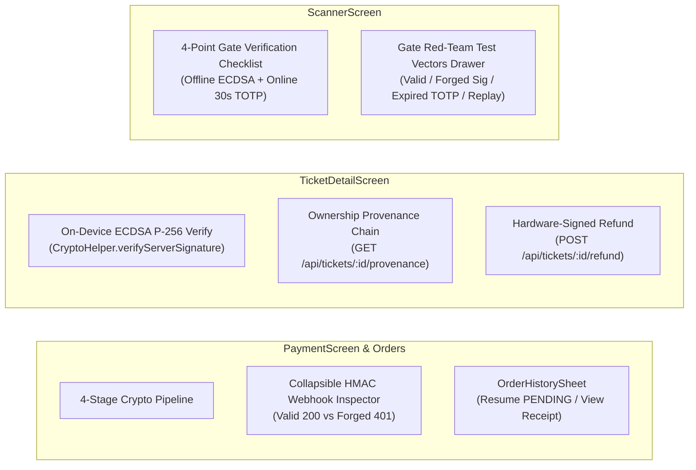

# Phase 3: Payment Pipeline, Order History, Ticket Provenance & 2-Stage Gate Scanner

## Overview
Upgrade the payment checkout, order recovery, ticket custody, and gate validation screens so every financial and ticket lifecycle action operates with production UX and surfaces verifiable cryptographic proofs (`PaymentScreen.kt`, `OrderHistorySheet`, `TicketDetailScreen.kt`, and `ScannerScreen.kt`).

## Requirements
- **Functional**:
  - **`PaymentScreen.kt` Upgrade**:
    - Display the locked **Zone & Seat Badge** (`VD: VIP-A · Ghế 18`) and exact tier amount (`2.000 ₫ – 3.000 ₫`) in the checkout header.
    - Replace the primary blue `"Xác nhận đã chuyển khoản"` bypass button with a **4-Stage Live Cryptographic Payment Pipeline** card (`1. Chữ ký đặt ghế TEE ECDSA P-256` → `2. Mã VietQR EMVCo CRC-16` → `3. Lắng nghe Webhook SePay HMAC-SHA256` → `4. Ký số & Cấp phát vé định danh`) and a primary `"Kiểm tra trạng thái giao dịch ngay"` polling refresh button.
    - Relocate webhook testing into a collapsible **"Security & Webhook Sandbox Inspector"** drawer with two live actions:
      1. **"Gửi Webhook SePay Hợp lệ (HMAC-SHA256 Signed → 200 OK)"**: Calls `POST /api/payment/simulate-signed-webhook` with `attackMode = "VALID"`, displays the verified HMAC digest snippet, and triggers `PaymentSuccessOverlay`.
      2. **"Tấn công Giả mạo Webhook (Tampered HMAC → 401 Blocked)"**: Calls `POST /api/payment/simulate-signed-webhook` with `attackMode = "INVALID_HMAC"` and displays the live `HTTP 401 SEPAY_WEBHOOK_INVALID_SIGNATURE` defense proof in a `CryptoTerminalBox`.
  - **Order History & Cryptographic Receipts (`OrderHistorySheet` in `HomeScreen.kt`)**:
    - Accessible from the Wallet (`TicketsWalletView`) and `HomeMainView`, fetching `GET /api/payment/my-orders`.
    - Allows users to **Tiếp tục thanh toán** (resume any active `PENDING` order straight back into `PaymentScreen.kt`), **Hủy giữ ghế** (`cancelOrder`), or inspect the **Biên lai Mật mã (Cryptographic Payment Receipt)** of `PAID` orders.
  - **`TicketDetailScreen.kt` Upgrade**:
    - Run `CryptoHelper.verifyServerSignature(...)` locally on-device when opening a ticket (using `securePrefs.getServerPublicKey() ?: CryptoHelper.DEFAULT_SERVER_PUBLIC_KEY_BASE64`) and display an interactive **"Chứng thư số ECDSA P-256 (Verified Offline On-Device)"** badge + parsed Zone/Seat badge.
    - Fetch `GET /api/tickets/:id/provenance` and display an expandable **"Chuỗi Sở hữu & Lịch sử Chuyển nhượng (Provenance Chain)"** timeline showing original minting + every hardware-signed transfer hop + canonical signature payload in a `CryptoTerminalBox`.
    - Add a **"Hủy / Hoàn trả vé (TEE Signed Refund)"** button for `ACTIVE` tickets that requests biometric verification, signs `REFUND:<ticketId>:<nonce>:<timestamp>` via `KeystoreManager.signRefundPayload`, calls `POST /api/tickets/:id/refund`, and returns the seat to inventory.
  - **`ScannerScreen.kt` Upgrade**:
    - Remove the hardcoded `"Mô phỏng"` (`SEC-P12-2026`) button.
    - On every scan, execute **Stage 1 (Local Pre-Flight ECDSA Verification / Schema Check)** on-device in `<15ms` alongside **Stage 2 (Backend 30s TOTP & Anti-Replay Check-In)**, rendering a **4-Point Cryptographic Gate Verification Checklist** (`1. Cấu trúc JSON & Đồng bộ giờ`, `2. Chữ ký Server ECDSA P-256 (Offline Verify)`, `3. Mã TOTP 30s xoay vòng`, `4. Chống phát lại (Anti-Replay) / NFC HCE`).
    - Add a collapsible **"Gate Red-Team Test Vectors"** drawer allowing 1-tap testing of: (a) Live Valid Ticket QR from local Vault, (b) Forged ECDSA Signature QR (`400 FORGED_TICKET_DETECTED`), (c) Expired 30s TOTP Screenshot QR (`400 Dynamic QR verification failed`), and (d) Replayed Already-Used Ticket QR (`409 FAILED_ALREADY_USED`).
- **Non-functional**:
  - Maintain `<15ms` local ECDSA verification latency on `TicketDetailScreen` and `ScannerScreen`.

## Architecture

## Related Code Files
- Modify: `app/src/main/java/com/example/quan_ly_ticket/ui/screens/PaymentScreen.kt`
- Modify: `app/src/main/java/com/example/quan_ly_ticket/ui/screens/HomeScreen.kt`
- Modify: `app/src/main/java/com/example/quan_ly_ticket/ui/screens/TicketDetailScreen.kt`
- Modify: `app/src/main/java/com/example/quan_ly_ticket/ui/screens/ScannerScreen.kt`

## Implementation Steps
1. **Upgrade `PaymentScreen.kt`**:
   - Show the locked `seatZone` / `seatNumber` pill in the hero header.
   - Add the **4-Stage Cryptographic Payment Pipeline** card and replace the primary `"Xác nhận đã chuyển khoản"` button with `"Kiểm tra trạng thái giao dịch ngay"` (triggering an immediate status poll).
   - Add the collapsible **"Security & Webhook Sandbox Inspector"** card with `"Gửi Webhook SePay Hợp lệ (HMAC-SHA256)"` and `"Thử Tấn công Giả mạo Chữ ký Webhook (401)"`, rendering the live HMAC verification output inside a `CryptoTerminalBox`.
2. **Add `OrderHistorySheet` in `HomeScreen.kt`**:
   - Add a `"Đơn hàng & Biên lai"` button on `TicketsWalletView` (and `HomeMainView`) that opens `OrderHistorySheet`, loads `api.getMyOrders()`, and lets the user resume any `PENDING` order into `onProceedToPayment(order)`, cancel a `PENDING` order, or view the cryptographic receipt of `PAID` orders.
3. **Add Offline ECDSA Verification, Provenance Chain & Signed Refund to `TicketDetailScreen.kt`**:
   - Compute `CryptoHelper.verifyServerSignature(CryptoHelper.buildTicketCanonicalString(ticket, securePrefs.getUserId() ?: ""), ticket.serverSignature, securePrefs.getServerPublicKey() ?: CryptoHelper.DEFAULT_SERVER_PUBLIC_KEY_BASE64)` on load and render the **"Chứng thư số ECDSA P-256 (Verified Offline)"** card.
   - Load `api.getTicketProvenance(ticket.id)` and display the ownership chain timeline (`Khởi tạo vé gốc` → `Chuyển nhượng P2P #1..N`) + expandable `CryptoTerminalBox` with canonical string and signature fingerprint.
   - Add `"Hoàn trả vé & Hủy giữ chỗ (Ký số TEE)"` for `ACTIVE` tickets, guarded by `onRequireBiometric` and `KeystoreManager.signRefundPayload`.
4. **Upgrade `ScannerScreen.kt` with 2-Stage Verification & Gate Red-Team Vectors**:
   - Parse scanned QR JSON on-device, check `CryptoHelper.verifyServerSignature` against any cached ticket/provenance or verify payload structure & timestamp drift, then call `api.validateQr(...)` and render the 4-row **Cryptographic Gate Verification Checklist** with measured latency (`ms`).
   - Replace the `"Mô phỏng"` button with a collapsible **"Gate Red-Team Test Vectors"** card that dynamically constructs (1) a live valid TOTP QR from the device's `EncryptedTicketVault` (or active ticket), (2) a forged-signature QR payload, (3) an expired TOTP (`ts - 20`) QR payload, and (4) a replay double-scan payload, running each through `processValidation(...)` so the backend returns real verification/rejection responses and logs them to SIEM.

## Success Criteria
- [x] `PaymentScreen.kt` no longer uses `"Xác nhận đã chuyển khoản"` as its primary CTA; users can inspect the 4-stage pipeline and test both valid and tampered HMAC-SHA256 webhooks in the collapsible inspector.
- [x] Users can open `"Đơn hàng & Biên lai"` in `HomeScreen.kt` to resume a `PENDING` order or inspect a `PAID` cryptographic receipt.
- [x] `TicketDetailScreen.kt` shows the local offline ECDSA P-256 verification status, the provenance timeline, and allows hardware-signed ticket refund.
- [x] `ScannerScreen.kt` has zero `"SEC-P12-2026"` hardcoded mock buttons, displays the 4-point cryptographic verification checklist, and tests all 4 Gate Red-Team vectors against the live backend.

## Risk Assessment
- **Risk**: In `TicketDetailScreen.kt`, if `ticket.currentOwnerId` or `ticket.issuedTimestamp` was missing from an older cached vault entry, `buildTicketCanonicalString` might use a fallback timestamp and report a false-negative local signature check.
  - *Signal*: Local offline ECDSA badge shows unverified on a valid ticket.
  - *Mitigation*: Enrich `ticket` from `GET /api/tickets/:id/provenance` (which returns the authoritative `canonicalString` and `issuedTimestamp` from MySQL) while using `buildTicketCanonicalString` offline when `issuedTimestamp != null && currentOwnerId != null`.
