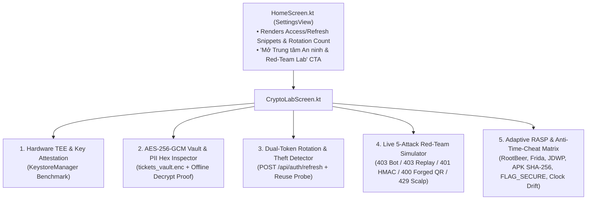

# Phase 4: Interactive 5-Module Security & Red-Team Center & Verification

## Overview
Create the dedicated **`CryptoLabScreen.kt`** ("Trung tâm An ninh & Red-Team Lab"), wire the orphaned token-rotation state in `HomeScreen.kt` (`SettingsView`), connect navigation in `MainActivity.kt`, and run full-stack automated verification across the Node.js backend and Android Gradle build.

## Requirements
- **Functional**:
  - Wire the orphaned variables `accessSnippet`, `refreshSnippet`, `rotationCount`, and `isRotating` in `HomeScreen.kt` (`SettingsView` lines 1154–1161) into a live **Phiên Dual-Token & Bảo mật Thiết bị** card with a prominent button to launch **`CryptoLabScreen.kt`**.
  - Build `CryptoLabScreen.kt` (`app/src/main/java/com/example/quan_ly_ticket/ui/screens/CryptoLabScreen.kt`) with 5 interactive modules:
    1. **Module 1: Hardware Keystore & TEE / StrongBox Attestation**:
       - Displays `KeystoreManager.getHardwareSecurityLevel()`, curve `ECDSA P-256 (secp256r1)`, device public key SPKI SHA-256 fingerprint, pinned Server Public Key fingerprint, and a 1-tap **"Chạy Kiểm thử Ký số Phần cứng TEE"** benchmark showing canonical challenge, Base64 signature, and signing latency in `ms`.
    2. **Module 2: Zero-Plaintext AES-256-GCM Vault & Offline Airplane-Mode Proof**:
       - Displays raw on-disk ciphertext from `EncryptedTicketVault.getRawEncryptedVaultSample()` (`tickets_vault.enc`) and `EncryptedTicketVault.getRawEncryptedCustomerPiiSample()` (`customer_pii_vault.enc`) inside `CryptoTerminalBox` blocks alongside a **"Giải mã Kiểm chứng Offline (TEE AES-256-GCM)"** trigger that proves local vault & PII decryption without network access.
    3. **Module 3: Dual-Token Rotation & Token-Reuse Theft Detector**:
       - Displays active Access Token (15m) & Refresh Token (7d) JTI/hash snippets and rotation count.
       - Provides two live buttons:
         - **"Xoay vòng Token Hợp lệ (`POST /api/auth/refresh`)"**: Rotates the token pair, saves the new tokens, and retains the *previous* revoked refresh token in memory for the theft test.
         - **"Mô phỏng Kẻ gian Đánh cắp & Dùng lại Refresh Token cũ"**: Sends the already-rotated refresh token to `POST /api/auth/refresh` (or generates a dedicated sub-session rotation + reuse probe so the user isn't forcibly logged out of their demo session unless desired) and displays the live **`HTTP 403 CRITICAL: REFRESH_TOKEN_REUSE_DETECTED`** server response.
    4. **Module 4: Live 5-Attack Red-Team vs. Defense Simulator**:
       - Fires real HTTP requests against the backend and displays the live HTTP status code, server error message, and triggered defense rule in a `CryptoTerminalBox`:
         - **Attack 1 — Bot cURL Đặt vé Không có Chữ ký Phần cứng TEE**: Calls `POST /api/payment/create-vietqr` with empty `deviceSignature` → **`HTTP 403 BOT_BUY_ATTEMPT_BLOCKED`**.
         - **Attack 2 — Tấn công Phát lại (Replay Attack Consumed Nonce)**: Sends two requests with the same `clientNonce` → **`HTTP 403 BUY_REPLAY_NONCE_BLOCKED`**.
         - **Attack 3 — Giả mạo Webhook Ngân hàng SePay (Tampered HMAC-SHA256)**: Calls `POST /api/payment/simulate-signed-webhook` with `attackMode = "INVALID_HMAC"` → **`HTTP 401 SEPAY_WEBHOOK_INVALID_SIGNATURE`**.
         - **Attack 4 — Vé Giả mạo Chữ ký Server ECDSA P-256 tại Cổng Soát Vé**: Calls `POST /api/validate/validate-qr` with a tampered `sig` → **`HTTP 400 FORGED_TICKET_DETECTED`**.
         - **Attack 5 — Đầu cơ Gom vé Vượt Hạn mức Anti-Scalping (> 6 Vé)**: Probes quota enforcement on `/create-vietqr` / `/buy` → **`HTTP 403/429 ANTI_SCALPING_QUOTA_EXCEEDED`**.
    5. **Module 5: Adaptive RASP, Anti-Screen-Capture & Clock-Drift Matrix**:
       - Displays the live 7-point sensor grid from `SecurityCheck.checkDeviceSecurity(context)`: RootBeer status, Frida `/proc/self/maps` & TCP ports `27042/27043`, JDWP Debugger check, APK SHA-256 Signing Certificate fingerprint, `FLAG_SECURE` WindowManager protection, `DisplayManager` secondary-display QR shield, and HTTP `Date` header Anti-Time-Cheat clock drift (`SecurityCheck.lastClockDriftSeconds`).
- **Non-functional**:
  - In Module 3's Stolen Refresh Token Replay test, ensure that after demonstrating `HTTP 403 REFRESH_TOKEN_REUSE_DETECTED`, the simulator automatically re-authenticates or uses an isolated probe token pair so the presenter's active UI session remains smooth during a live defense!

## Architecture

## Related Code Files
- Create: `app/src/main/java/com/example/quan_ly_ticket/ui/screens/CryptoLabScreen.kt`
- Modify: `app/src/main/java/com/example/quan_ly_ticket/ui/screens/HomeScreen.kt`
- Modify: `app/src/main/java/com/example/quan_ly_ticket/MainActivity.kt`
- Modify: `backend/src/test/securityRedTeamTest.js`

## Implementation Steps
1. **Create `CryptoLabScreen.kt`**:
   - Build the 5-module interactive security & Red-Team console using `GlassCard`, `CryptoTerminalBox`, `FrostedIconButton`, and semantic status pills (`SuccessBg`/`SuccessFg`, `DangerBg`/`DangerFg`).
   - Implement the 5 live Red-Team network probes and the isolated Dual-Token Reuse Theft probe so every button produces real, verifiable backend responses and latency measurements.
2. **Wire `SettingsView` in `HomeScreen.kt` and `Screen.CRYPTO_LAB` in `MainActivity.kt`**:
   - Render `accessSnippet`, `refreshSnippet`, `rotationCount`, and `isRotating` in `SettingsView` with a live `"Xoay vòng Token ngay"` button and a primary card launching `onOpenCryptoLab()`.
   - Add `Screen.EVENT_BOOKING` and `Screen.CRYPTO_LAB` to `MainActivity.kt` navigation state.
3. **Full-Stack Verification**:
   - Run `node --check` on all modified backend files and execute backend red-team tests.
   - Run `./gradlew assembleDebug testDebugUnitTest` and verify zero compilation errors, zero raw `Card(` instances in `ui/screens/`, and zero overt demo shortcuts on primary screens.

## Success Criteria
- [x] `CryptoLabScreen.kt` is reachable from `HomeScreen.kt` (`SettingsView`) and executes all 5 interactive modules against the real backend and hardware Keystore.
- [x] `HomeScreen.kt` has zero unused-variable warnings for `accessSnippet`, `refreshSnippet`, `rotationCount`, or `isRotating`.
- [x] `./gradlew assembleDebug testDebugUnitTest` exits with code `0`.

## Risk Assessment
- **Risk**: Triggering `REFRESH_TOKEN_REUSE_DETECTED` directly on the user's primary `refreshToken` revokes all refresh tokens for `req.user.id` in `authRoutes.js`, which would fail subsequent token refreshes until re-login.
  - *Signal*: Subsequent 401 refresh fails after running the Token Theft probe.
  - *Mitigation*: After the Token Theft probe receives `HTTP 403 REFRESH_TOKEN_REUSE_DETECTED`, automatically re-issue a fresh background login/token pair for the active demo account (or run the theft probe against a fresh ephemeral token family) so the evaluator sees the real `403 CRITICAL` server block and SIEM log without breaking their active session.
